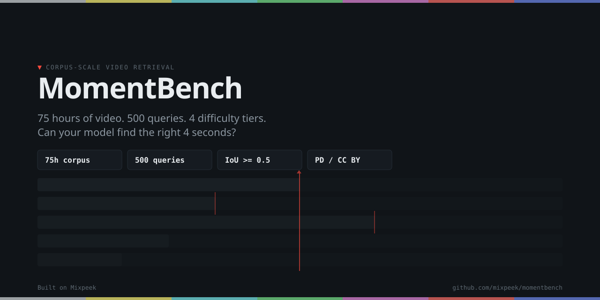

<p align="center">
  
</p>

# MomentBench

**[momentbench.com](https://momentbench.com)** — Corpus-scale video moment retrieval benchmark.

**Design target:** 75 hours of rights-cleared video, 500 queries across 4 difficulty tiers, evaluated against frontier models and retrieval pipelines.

**Current release (v0.2):** 27 hash-verified assets in three domains: 7 Blender open movies (about 72 minutes), 13 NASA aerospace videos (about 32 minutes, 2022 to 2026) and 7 NASA robotics videos (about 13 minutes, 2019 to 2023), with machine transcripts in [`data/transcripts`](data/transcripts). Queries:

- [`data/queries/film_v0.2.json`](data/queries/film_v0.2.json): 185 public film queries across all four tiers; 82 more are held out.
- [`data/queries/aerospace_v0.2.json`](data/queries/aerospace_v0.2.json): 202 NASA queries across all four tiers, 164 `public` and 38 `rolling` (footage published after current model training cutoffs); 65 more are held out.
- [`data/queries/robotics_v0.2.json`](data/queries/robotics_v0.2.json): 70 public NASA robotics queries across all four tiers; 16 more are held out.
- [`data/queries/sample.json`](data/queries/sample.json): the 4-query v0.1 seed, kept for comparison with earlier runs.

In total 620 queries across film, aerospace and robotics, 457 in this repository. They were drafted and verified by Claude, then cross-checked by Gemini, and only queries both agreed on were kept (37 of 657 were dropped at that step). They have not had human review yet; a 20-query spot check put the error rate before cross-checking at about 10%. The technical report is [`docs/report.md`](docs/report.md); current scores are in [`docs/results.md`](docs/results.md). [`docs/protocol.md`](docs/protocol.md) defines the task, metrics and what a reported result must state, and describes how the queries were built. [`docs/scope.md`](docs/scope.md) states what a v0.2 score measures and what it does not, with a roadmap for each gap. PRs adding rights-cleared footage or queries are welcome (see [`SUBMISSION.md`](SUBMISSION.md)).

Maintained by [Mixpeek](https://mixpeek.com). Mixpeek's own pipeline is one entrant on the leaderboard and follows the same rules as every other. See [`GOVERNANCE.md`](GOVERNANCE.md).

## Quick Start

Evaluate a model on the v0.2 agentic track in three commands:

```bash
pip install -e ".[openai]"   # or .[gemini], .[claude-code], .[inspect]
momentbench corpus-download -m data/corpus_manifests/sample_manifest.json --corpus-dir corpus/   # 2.6 GB
momentbench agentic <model> --provider openai-compatible --base-url http://localhost:8000/v1 \
  -q data/queries/film_v0.2.json -c data/corpus_manifests/sample_manifest.json --corpus-dir corpus/
```

`--provider` is one of `openai-compatible` (vLLM, SGLang, Ollama and other `/v1/chat/completions` servers), `openai`, `gemini`, `anthropic`, `claude-code` or `baseline`. [`docs/integrating.md`](docs/integrating.md) covers each route, including a runnable template for your own agent ([`examples/custom_agent.py`](examples/custom_agent.py)) and the Inspect AI task. Scores so far are in [`docs/results.md`](docs/results.md); compare yours against the `baseline-random` and `baseline-abstain` floors there.

## For world-model and physical-AI teams

MomentBench asks whether a system can find one specific moment in a large corpus of video. These parts of it target physical understanding directly:

- **Robotics domain** ([`data/queries/robotics_v0.2.json`](data/queries/robotics_v0.2.json)): NASA rovers on slopes and ramps, free-flying robots and a Mars helicopter, from test labs and from flight.
- **Physical-event subset**: queries tagged `metadata.physical_event`, in which a machine visibly moves or makes contact (a wheel onto a ramp, a rocket leaving the pad, a capsule under drogue parachutes, a splashdown). Run only these with `--physical-only`, or `-T physical_only=true` under Inspect.
- **Visual-only ablation**: `--no-transcripts` removes speech, so a score reflects what the model saw rather than what was said.
- **Title control**: `--anonymize-titles` hides titles and descriptive asset ids, so a model cannot pick a video by its name.
- **Temporal precision**: Recall@1 is reported at tIoU 0.3, 0.5 and 0.7, and tier 4 asks for ordered cause-and-effect across consecutive shots.

What it does not have yet: robot manipulation (grasping and placing), egocentric footage or driving. Openly licensed robot-learning datasets are candidates for v0.3, each pending its own licence review. PRs with rights-cleared footage are welcome.

## Query Tiers

Difficulty targets were pre-registered before any baseline evaluations were run.

| Tier | Name | Description | Pre-registered difficulty target |
|------|------|-------------|----------------------------------|
| 1 | Single-condition visual | Identify a single visual event | >80% recall for frontier models |
| 2 | Cross-modal joint | Joint reasoning across modalities | 50-70% recall |
| 3 | Corpus-scale hard negatives | Discriminate near-duplicates at corpus scale | <35% recall |
| 4 | Temporal reasoning | Temporal ordering and sequence reasoning | <25% recall |

## Verticals

Target scope per vertical, with the v0.2 asset count:

- **Film** (target ~20h, v0.2: 7 assets): Blender open movies; Prelinger Archives and National Archives planned
- **Aerospace** (target ~25h, v0.2: 13 assets): NASA mission recaps, explainers and NASA Minute episodes
- **Robotics** (v0.2: 7 assets): NASA rover, free-flyer and helicopter footage, from flight and from test labs. Queries target physical events: contact, wheels on slopes, lift-off and landing, cause then effect
- **Civic** (target ~30h, v0.2: none): congressional hearings and agency briefings are planned. The v0.1 Senate asset was dropped because its source link no longer resolves

## Scoring

- **Hit**: correct asset AND temporal IoU ≥ 0.5 vs gold moment
- **Metrics**: Recall@1, Recall@5, mean temporal IoU, per-tier breakdowns
- **No-answer queries**: a query with an empty `gold_moments` list has no match in the corpus. It is a hit only when the system returns no moments. On the agentic track that takes an explicit empty submission; a refusal or a run that hits its limit is a miss. Tier 3 in v0.2 is made of these: real shots with one concrete detail changed.

## Getting the Corpus

```bash
momentbench corpus-download -m data/corpus_manifests/sample_manifest.json --corpus-dir corpus/
momentbench corpus-verify   -m data/corpus_manifests/sample_manifest.json --corpus-dir corpus/
```

`corpus-download` fetches every asset whose manifest entry has a `file` block (all 20 in v0.2) and checks its sha256. `corpus-verify` checks presence, sha256 and duration for every asset and exits non-zero if any fails.

## Agentic Track

The agentic track measures a tool-using model. The model cannot watch video. It gets five tools (`list_assets`, `search_transcript`, `read_transcript`, `sample_frames`, `submit_answer`) and a per-query budget of frames, tool calls and turns, and it must submit a video and a time span.

```bash
momentbench agentic claude-opus-5-5 \
  -q data/queries/sample.json -c data/corpus_manifests/sample_manifest.json \
  --corpus-dir /path/to/videos --effort high --trials 5
```

- **Corpus on disk:** `--corpus-dir` holds `<asset_id>.mp4` (or `.mov`, `.mkv`). Transcripts are read from `--transcripts-dir`, default `data/transcripts`. Queries whose gold video is missing are skipped, and the run says how many.
- **Repeated trials:** each query runs `--trials` times. Recall@1 is the mean over trials, with a 95% bootstrap interval resampled over queries.
- **Cost:** token usage is recorded per trial and priced from [`configs/pricing.json`](configs/pricing.json), which carries an as-of date. Report Recall@1 against cost per query at each effort level.
- **Failures count:** a trial that refuses, hits the turn limit or never submits scores zero and stays in the denominator.
- **No retrieval index:** transcript search is plain keyword overlap, so no entrant depends on a vendor's embeddings.

The same track runs under [Inspect AI](https://inspect.aisi.org.uk/), with the same tools, budget and scoring rule:

```bash
pip install -e ".[inspect]"
inspect eval momentbench/agentic/inspect_task.py --model anthropic/claude-opus-5-5 \
  -T corpus_dir=/path/to/videos --epochs 1
# defaults to the film, aerospace and robotics v0.2 files; -T queries=a.json,b.json to change
```

To run through a local Claude Code install instead of an API key, add `--provider claude-code` (and `pip install -e ".[claude-code]"`). The Claude Agent SDK runs the tool loop with Claude Code's built-in tools, settings and other MCP servers switched off and the benchmark's system prompt in place of Claude Code's. The corpus tools charge the same budget. Each run records `harness: "claude-code"` or `harness: "api"`, so results from the two are never mixed silently.

GPT and Gemini run with `--provider openai` (needs `OPENAI_API_KEY`, `pip install -e ".[openai]"`) and `--provider gemini` (needs `GEMINI_API_KEY`, `pip install -e ".[gemini]"`). Every provider gets the same tools and budget, and frames go back inside the tool result at the same resolution. OpenAI frames are sent at `detail: high` so they are not downscaled.

Requires `ffmpeg` on the PATH. Other providers implement `momentbench.agentic.model.AgentModel`. Results are in [`docs/results.md`](docs/results.md), generated by `scripts/results_doc.py` from the run files it cites.

## Contamination Control

Every query carries a canary string, and queries are assigned to a `public`, `held_out` or `rolling` split. Held-out queries are kept outside this repository and scored by the maintainers. Rolling queries use footage published after 2026-06-30. See [`docs/contamination.md`](docs/contamination.md).

## Corpus Licensing

All footage is public domain (17 U.S.C. § 105) or CC BY, permitting commercial derivatives. See [`ATTRIBUTION.md`](ATTRIBUTION.md) for full provenance.

## Project Structure

```
momentbench/
├── momentbench/           # Core library
│   ├── eval/              # Scoring engine
│   ├── models/            # Legacy single-call adapters (see input_kind)
│   ├── corpus/            # Corpus management & sourcing
│   ├── taxonomy/          # Query tier definitions & generation
│   └── mixpeek_integration/  # Mixpeek pipeline integration
├── site/                  # Leaderboard (momentbench.com)
├── scripts/               # Automation scripts
├── configs/               # Benchmark configuration
├── data/                  # Queries, manifests, results
└── tests/                 # Test suite
```

## Legacy adapters (`momentbench run`)

For multimodal evaluation use the agentic track (`momentbench agentic`): the model
samples frames and reads transcripts through tools, and every reported number on this
page comes from it. The adapters below are the older single-call track. Each declares an
`input_kind`, which `momentbench run` prints and records in the run's config:

- **metadata-only**: the model sees asset titles and durations, no frames, audio or
  transcript. It measures guessing from titles.
- **whole-video-control**: ranks videos by title/description text and returns the whole
  video as the span. A retrieval floor, with no localization.
- **indexed-platform**: queries a provider's index built from the media; segment times
  come from the provider.

| Adapter | Model | Input kind |
|---------|-------|------------|
| `gemini` | Gemini 2.5 Pro | metadata-only |
| `openai` | GPT-4.1 | metadata-only |
| `claude` | Claude Sonnet 4 | metadata-only |
| `qwen-vl` | Qwen3-VL / Qwen2.5-VL (vLLM, SGLang) | metadata-only |
| `hf-vlm` | Any OpenAI-compatible VLM server | metadata-only |
| `clip` | OpenAI CLIP (ViT-L/14) | whole-video-control |
| `jina-clip` | Jina CLIP v2 | whole-video-control |
| `mixedbread` | mxbai-embed-large | whole-video-control |
| `e5-omni` | E5-Omni (Microsoft) | whole-video-control |
| `twelvelabs` | TwelveLabs Marengo | indexed-platform |
| `mixpeek` | Mixpeek pipeline | indexed-platform |

```bash
# Run API-based models
TWELVELABS_API_KEY=... momentbench run twelvelabs -q data/queries/sample.json -c data/corpus_manifests/sample_manifest.json
MIXEDBREAD_API_KEY=... momentbench run mixedbread -q data/queries/sample.json -c data/corpus_manifests/sample_manifest.json

# Run OSS models (requires a local inference server or GPU)
QWEN_API_BASE=http://localhost:8000/v1 momentbench run qwen-vl -q data/queries/sample.json -c data/corpus_manifests/sample_manifest.json
momentbench run clip -q data/queries/sample.json -c data/corpus_manifests/sample_manifest.json

# Run only OSS baselines
OSS_ONLY=1 ./scripts/run_all_baselines.sh

# Run only closed-source baselines
CLOSED_ONLY=1 ./scripts/run_all_baselines.sh
```

Install OSS dependencies: `pip install -e ".[oss]"`

## Submit Results

We welcome external submissions. Run the agentic track on a whole query file, package the run, and open a PR adding the directory it writes under `submissions/`. [`SUBMISSION.md`](SUBMISSION.md) has the steps and what is checked.

```bash
momentbench submit \
  --results data/results/agentic/agentic-<model>-<id>.json \
  --model-name "Your Model" \
  --contact you@example.com
```

## Run Your Own Footage

```bash
# Ingest your video corpus into Mixpeek
momentbench ingest -m your_manifest.json

# Run decomposition
momentbench decompose -m your_manifest.json

# Evaluate
momentbench run mixpeek -q your_queries.json -c your_manifest.json
```

## Citation

```bibtex
@software{momentbench2025,
  title     = {MomentBench: Corpus-Scale Video Moment Retrieval Benchmark},
  author    = {Mixpeek},
  year      = {2025},
  url       = {https://github.com/mixpeek/momentbench},
  license   = {Apache-2.0}
}
```

## License

Apache-2.0
